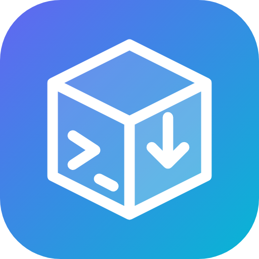

# PSADT Frontend



A self-hosted web UI for building [PSAppDeployToolkit](https://psappdeploytoolkit.com/) (PSADT v4) packages. You can:

- edit install, uninstall and repair steps in a browser,
- upload installers,
- preview the generated `Invoke-AppDeployToolkit.ps1`,
- export a ready-to-deploy ZIP or an Intune `.intunewin`.

No Windows build machine is needed. It runs as a Docker container or in a Debian LXC, and both behave identically. See [CONTRIBUTING.md](CONTRIBUTING.md) and [SECURITY.md](SECURITY.md).

**Version:** 0.1.55 (see `VERSION`)

## Status and roadmap

| Step | Content | Status |
|------|---------|--------|
| 1 | Foundation: FastAPI + React, cookie login, Docker, LXC | ✅ v0.0.50 |
| 2 | Package editor based on the PSADT v4 template, uploads, live script preview | ✅ v0.0.61 |
| 3 | Build/export: ZIP, `.intunewin`, detection rules, snippet library | ✅ v0.0.72 |
| 4 | Open source: roles, user management, docs, GHCR image | ✅ v0.0.83 |
| 5 | Proxmox helper script (community-scripts style) | ✅ v0.1.0 |
| 6 | UI in English, Dutch and German (language picker), in-app updates for LXC (System page) | ✅ v0.1.22 |
| 7 | Check before download, upload retention, default log folder, new icon and design | ✅ v0.1.33 |
| 8 | Language per user (stored on the account, follows the user to every device) | ✅ v0.1.44 |
| 9 | Plain-language release notes on the System page (EN/NL/DE) | ✅ v0.1.55 |

## Architecture

```
backend/   FastAPI (Python 3.12+), SQLAlchemy + SQLite, argon2
  app/config.py            settings via PSADT_* environment variables
  app/db.py                models: users, sessions, packages, snippets
  app/security.py          passwords, sessions, CSRF, first admin
  app/routers/auth.py      /api/auth/login | logout | me | password
  app/routers/packages.py  /api/packages CRUD, /script, /check, /files, /detection, /export
  app/routers/snippets.py  /api/snippets (reusable steps)
  app/routers/users.py     /api/users (admins only)
  app/routers/system.py    /api/system/update and /settings (admins only): version check, in-app update, upload retention
  app/retention.py         removes uploads after the chosen retention (hourly, and right after export if chosen)
  app/psadt/validate.py    the check before a download (/api/packages/{id}/validate); errors block the export
  app/psadt/schema.py      allowed step types + validation (whitelist)
  app/psadt/generator.py   builds Invoke-AppDeployToolkit.ps1
  app/psadt/template_*.ps1 header/footer of the official PSADT 4.1.8 template
  app/psadt/check.ps1      syntax check with the PowerShell parser (runs nothing)
  app/psadt/export.py      ZIP (official PSADT package + script + Files) and .intunewin
  app/psadt/detection.py   Intune detection script from detection rules
  app/main.py              app, security headers, serves frontend/dist
  tests/                   pytest
frontend/  React 18 + Vite (build -> frontend/dist): Packages, Editor, Users, System
           src/i18n.js: UI languages (en, nl, de); the English text is the key, a missing translation shows English.
           Each user's language is stored in users.language (PUT /api/auth/language) and applied at sign-in.
.github/workflows/  ci.yml (tests + build), release.yml (tag + release + GHCR image from VERSION)
ct/psadt-frontend.sh            Proxmox helper (runs on the host)
install/psadtfrontend-install.sh  runs inside the new container, calls lxc/install.sh
install/update.sh               in-place updater, installed as /usr/local/bin/psadt-frontend-update
lxc/install.sh                  installer for a Debian LXC (systemd service + update units)
assets/icon.png      app icon (also used as Docker/Unraid icon); the SVG is frontend/public/favicon.svg
Dockerfile, docker-compose.yml
```

## Security (built in)

- The session lives in an `HttpOnly`, `Secure`, `SameSite=Strict` cookie. Only the sha256 hash of the token is stored, so signing out really revokes the session.
- A CSRF token (header `X-CSRF-Token`) is required on every write.
- Passwords are hashed with argon2. An account locks for 15 minutes after 5 failed attempts, and login is timing-safe.
- Security headers: CSP, X-Frame-Options, nosniff and Referrer-Policy. There is no `/docs` in production.
- The container runs as non-root on a read-only filesystem, with all capabilities dropped.
- For use on the internet, put a reverse proxy with HTTPS in front (Caddy or Traefik).

## Check before download

The Export tab checks the package before you can download it:

- **Errors** block the download, and the server refuses the export too. They cover a missing PSADT toolkit, invalid settings, steps that use a file that is not uploaded, a script that cannot be generated, and PowerShell syntax errors (when `pwsh` is available).
- **Warnings** do not block. They cover no main install or uninstall step, no detection rules, an empty vendor or version, and no uploaded files.

## Upload retention

On the **System** page an administrator chooses how long uploaded files stay on the server: keep forever (the default), remove right after a download, or remove after 1, 7, 30 or 90 days. The package itself is kept; only its files are removed. The cleanup runs at start-up, every hour, and when the setting is changed.

## Log folder

PSADT writes its log on the client to `$envWinDir\Logs\Software` by default. On the **System** page an administrator can set another default folder, and each package can override it under **App info**. The export writes the chosen folder into `Toolkit.LogPath` in the package's `Config/config.psd1`; MSI logs follow it automatically. PSADT variables such as `$envWinDir` and `$envProgramData` can be used. `LogPathNoAdminRights`, for packages that do not require admin rights, is left at its default.

## Roles

| Role | Can |
|------|-----|
| Administrator | everything, plus managing users (create, role, password, unlock, delete) and updates |
| Editor | create, change and delete packages and snippets |
| Read only | view everything, check scripts and export |

When a user's role or password changes, that user's sessions are revoked. The last administrator cannot be demoted or deleted.

## Running with Docker

A ready-made image is published after every release: `ghcr.io/starf0x/psadt-frontend:latest`. To use it, set `image:` instead of `build:` in `docker-compose.yml`.

```bash
cp .env.example .env        # adjust
docker compose up -d --build
docker compose logs | grep 'admin password'   # if PSADT_ADMIN_PASSWORD was empty
```

Open `http://<host>:8000`. To test locally without HTTPS, set `PSADT_COOKIE_SECURE=false`.

To update, run `docker compose pull && docker compose up -d`. The System page tells you when a newer version exists.

## Installing in an LXC container (Proxmox)

Run one command **on the Proxmox host**. It is a Proxmox VE helper script, built the same way as the community-scripts:

```bash
bash -c "$(curl -fsSL https://raw.githubusercontent.com/Starf0x/PSADT-Frontend/main/ct/psadt-frontend.sh)"
```

You get the familiar menu (Default / Advanced, storage, network, resources). The defaults are Debian 13, unprivileged, 2 cores, 2 GB RAM and a 16 GB disk. At the end the script shows the URL and the admin password. The password is also stored in `/root/psadt-frontend-admin.txt` inside the container.

How the helper fits together:

- `ct/psadt-frontend.sh` runs on the host. The engine comes from `community-scripts/core`, and `COMMUNITY_SCRIPTS_URL` points it at this repo.
- `install/psadtfrontend-install.sh` runs inside the container and calls `lxc/install.sh`. Its name is fixed by the engine: `${APP,,}` without spaces, plus `-install`.

**In an existing Debian LXC** (as root, not on the host):

```bash
PSADT_COOKIE_SECURE=false bash -c "$(curl -fsSL https://raw.githubusercontent.com/Starf0x/PSADT-Frontend/main/lxc/install.sh)"
journalctl -u psadt-frontend | grep 'admin password'
```

Files on an LXC install:

- configuration: `/etc/psadt-frontend.env`
- data: `/var/lib/psadt-frontend`
- source: `/opt/psadt-frontend-src`

`PSADT_COOKIE_SECURE=false` is needed as long as you use `http://`. Set it to `true` once an HTTPS proxy is in front.

### Updating an LXC install

There are three ways, and all of them do the same thing: move to the newest release tag and reinstall.

- **From the app:** sign in as an administrator, open **System** and click **Install it**. A progress bar follows the update, and the app restarts part way through.
- **In the container:** run `psadt-frontend-update`.
- **From the Proxmox host:** run the helper command above inside the container's console. On an existing install it offers an update.

How the in-app update works (same design as My Audiobook Collection):

1. The app runs as the unprivileged `psadt` user, so it cannot update itself.
2. It writes `/var/lib/psadt-frontend/update-wanted`.
3. The root unit `psadt-frontend-update.path` notices that file and starts `psadt-frontend-update.service`, which runs `/usr/local/bin/psadt-frontend-update` (`install/update.sh`).
4. The updater writes `update-progress.json` and `update-said.json` to the data folder, which the System page reads.
5. The updater only ever does this one fixed thing. Nothing is passed in, so asking for an update is not a privilege escalation.

Containers installed before v0.1.22 do not have the updater yet. Update them once from the Proxmox helper, or run `PSADT_SKIP_FETCH=1 bash /opt/psadt-frontend-src/lxc/install.sh` after a `git fetch --tags && git checkout <newest tag>` in `/opt/psadt-frontend-src`. After that, the in-app update works.

## Configuration

| Variable | Default | Meaning |
|----------|---------|---------|
| `PSADT_ADMIN_USERNAME` | `admin` | First user |
| `PSADT_ADMIN_PASSWORD` | empty | Empty = generated and logged once |
| `PSADT_COOKIE_SECURE` | `true` | Only `false` for local http |
| `PSADT_SESSION_HOURS` | `12` | Session lifetime |
| `PSADT_DATA_DIR` | `./data` (`/data` in Docker) | Database and uploads |
| `PSADT_MAX_UPLOAD_MB` | `4096` | Maximum upload size |
| `PSADT_TOOLKIT_ZIP` | `/opt/psadt/PSAppDeployToolkit_Template_v4.zip` | Official PSADT package used for export |
| `PSADT_PWSH_PATH` | `pwsh` (`/opt/pwsh/pwsh` in Docker/LXC) | PowerShell 7 for the syntax check |

## Development

```bash
cd backend && python -m venv .venv && . .venv/bin/activate
pip install -r requirements-dev.txt && pytest
PSADT_COOKIE_SECURE=false uvicorn app.main:app --reload    # :8000
cd ../frontend && npm install && npm run dev                # :5173, proxies /api
```

## Versioning

Versions start at 0.0.50 and go up by 11 per release (0.0.61, 0.0.72, ...). When the last part reaches 100 or more, it becomes 0.1.0, and so on.

## Notes for further work

- PowerShell 7.4.6 is in the Docker image and in `/opt/pwsh` via `lxc/install.sh`. Keep the version the same in both places.
- New PSADT version:
  - update `PSADT_VERSION` and `PSADT_SHA256` in the Dockerfile and in `lxc/install.sh`;
  - take the header/footer again from `src/PSAppDeployToolkit/Frontend/v4/Invoke-AppDeployToolkit.ps1` (replace the path `..\..\..\PSAppDeployToolkit` with `PSAppDeployToolkit`);
  - update `PSADT_VERSION` in `schema.py`.
- Releases: bump `VERSION` (+11), `frontend/package.json` and `docker-compose.yml`, and add a `## x.y.z` section to `release-notes/en.md`, `nl.md` and `de.md`. Write the notes for people, not programmers; a test fails when a section is missing. After the merge, `release.yml` creates the tag, the release (with the English notes on top) and the image.
- The System page reads the notes from GitHub (`main`), so a server can show what a newer version brings; without internet it falls back to the copy it shipped with.
- The .intunewin is tested cryptographically (roundtrip) but not yet uploaded to Intune. Check that the first time.
- In-app update (`install/update.sh`) has not yet run on a real Proxmox container. Check that the first time.
- To develop locally without `/opt/psadt`, download the template zip and set `PSADT_TOOLKIT_ZIP`.
- Tables are created with `create_all`; new columns on existing tables are added in `db._add_missing_columns()`. Move to Alembic when this grows.
- New UI text: wrap it in `t('English text')` and add a row with the Dutch and German to `frontend/src/i18n.js`. Server error messages are translated the same way in the browser.
- Possible next steps: 2FA (TOTP), an audit log, Alembic migrations.

## License

MIT, see `LICENSE`. PSADT parts are LGPL-3.0, see `NOTICE.md`.
