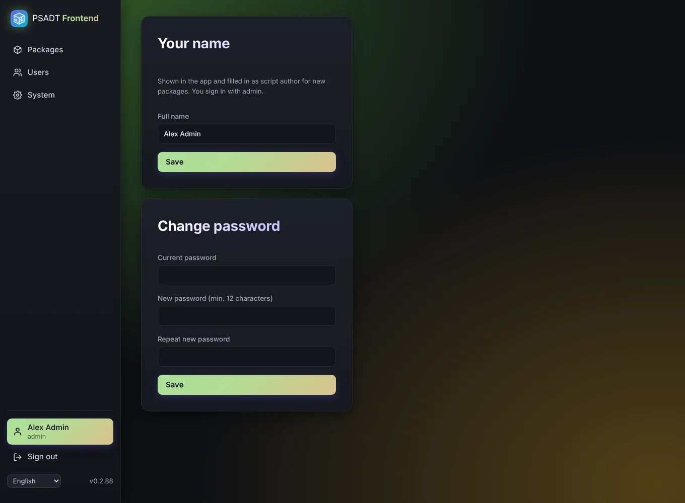

# Account and language

On the **Account** page every user can:

- change their **full name**,
- change their **password** (you need the current one),
- choose the **language** of the app: English, Nederlands or Deutsch.

The language is stored with your account, so it follows you to every browser and device. Texts that aren't translated yet are shown in English.
