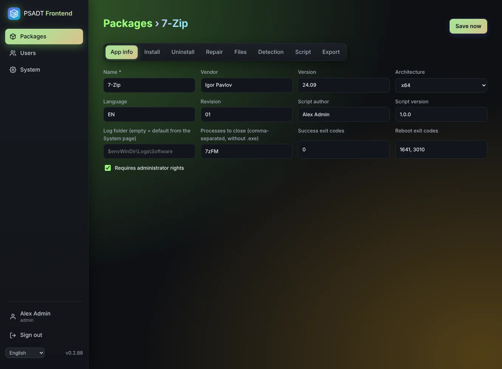

# App info

The **App info** tab holds the details that end up at the top of the generated script.

| Field | Meaning |
|-------|---------|
| Vendor, Name, Version | Shown in the PSADT dialogs and used for the file name of the export. Only *Name* is required. |
| Architecture | Empty (any), x86, x64 or arm64. |
| Language, Revision | Standard PSADT fields, used in the package name. |
| Author | Filled in with your full name for new packages. |
| Script version | Version of the deployment script itself. |
| Success exit codes | Exit codes that count as success (default `0`). |
| Reboot exit codes | Exit codes that mean "success, reboot needed" (default `1641, 3010`). |
| Processes to close | Programs that must be closed before installing, e.g. `chrome` or `winword`, without `.exe`. The *Welcome dialog* step asks the user to close them. |
| Requires admin rights | On for almost every machine-wide install. |
| Log folder | Where PSADT writes its log on the PC. Empty uses the default from the [System](System) page (normally `$envWinDir\Logs\Software`). PSADT variables such as `$envProgramData` are allowed. |
