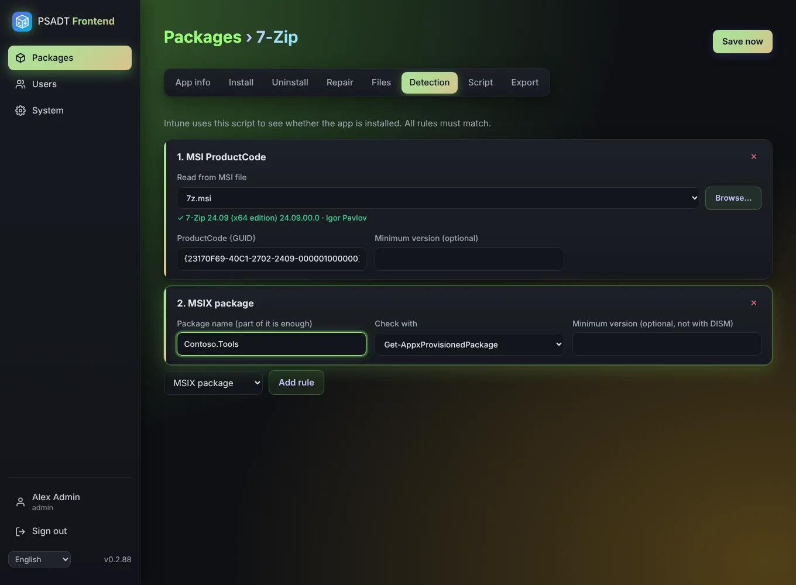

# Detection

Intune needs to know whether the app is installed. PSADT Frontend writes a **custom detection script** from the rules on this tab. **All rules must match** for the app to count as installed.

| Rule | Checks |
|------|--------|
| MSI ProductCode | The MSI with this ProductCode is installed, optionally with a minimum version. |
| File | A file exists (e.g. `%ProgramFiles%\Acme\app.exe`), optionally with a minimum file version. |
| Registry | A key exists, or a value exists, or a value has the expected content. |
| MSIX package | A provisioned MSIX/AppX package exists whose name contains your text. |

## Reading the ProductCode from an MSI

You don't have to look up the ProductCode yourself. Under **Read from MSI file**, choose an uploaded `.msi` with **Browse…**, or upload one from your PC there. The app reads the MSI on the server straight away and fills in the ProductCode. It also shows the product name and manufacturer, so you can check you picked the right file.

## MSIX

The MSIX rule offers two ways to check:

- **Get-AppxProvisionedPackage**, the same as `Get-AppxProvisionedPackage -Online | Where-Object DisplayName -like "*name*"`. Supports a minimum version.
- **DISM**, the same as `dism /online /get-provisionedappxpackages | findstr /i "name"`. No version check.

Part of the package name is enough.

## Using the script

The detection script is shown on the [Export](Export-and-Intune) tab and can be downloaded separately. In Intune choose *Use a custom detection script* and upload it.
