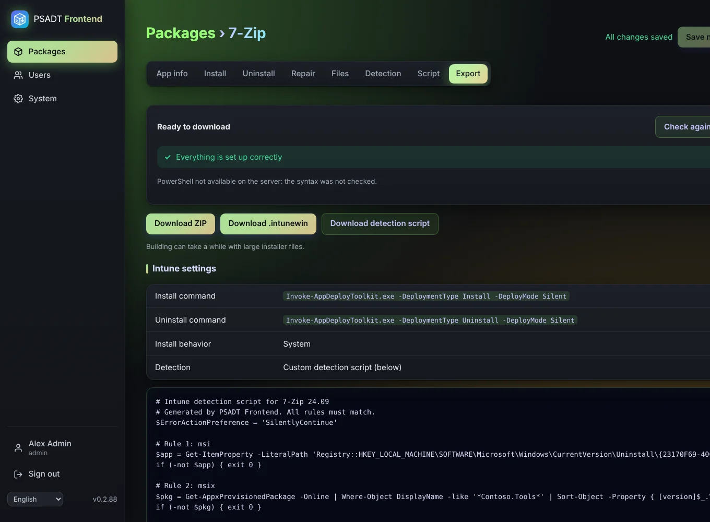

# Export and Intune

## Check before download

When you open the **Export** tab the app checks the package:

- **Errors** (red) block the download. Examples: the PSADT toolkit is missing, a step uses a file that isn't uploaded, a setting is invalid, or the script has a syntax error.
- **Warnings** (yellow) don't block. Examples: no main install or uninstall step, no detection rules, an empty vendor or version, no uploaded files.

The download buttons stay grey until all errors are fixed. Each button checks once more right before downloading, so a change made in another tab can't slip through.

## Downloading

| Button | You get |
|--------|---------|
| Download ZIP | The complete PSADT package: toolkit, `Invoke-AppDeployToolkit.ps1`, `Invoke-AppDeployToolkit.exe`, `Config` and your `Files`. |
| Download .intunewin | The same package, wrapped for Intune. |
| Download detection script | Only the [detection](Detection) script. |

A progress bar shows *Building the package…* and *Downloading…*. With large installers building can take a while. When the file is ready you see *Downloaded: <name>*.

## Adding the app to Intune

1. In Intune, go to **Apps > Windows > Add** and choose **Windows app (Win32)**.
2. Upload the `.intunewin`.
3. Use the values from the **Intune settings** table on the Export tab:
   - Install command: `Invoke-AppDeployToolkit.exe -DeploymentType Install -DeployMode Silent`
   - Uninstall command: `Invoke-AppDeployToolkit.exe -DeploymentType Uninstall -DeployMode Silent`
   - Install behavior: **System**
4. Under detection rules choose **Use a custom detection script** and upload the detection script.
5. Assign the app as usual.

Each export counts towards the [export counters](Packages), once per package version.
