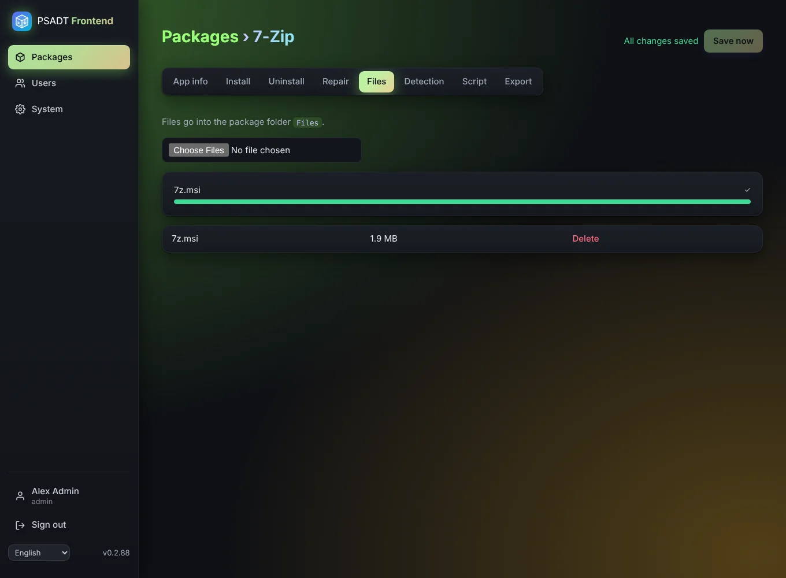

# Files

The **Files** tab holds the installers and other files the package needs. They end up in the `Files` folder of the exported package.

- Choose one or more files with the file picker. A progress bar shows each upload. The largest file size is set with `PSADT_MAX_UPLOAD_MB` (default 4 GB).
- Large files are sent in pieces of 5 MB, so they pass a reverse proxy or tunnel with a size limit. A failed piece is retried automatically; after a minute without progress the app stops and tells you.
- Every file can be removed again. The [check before download](Export-and-Intune) warns when a step uses a file that is no longer there.
- In steps you pick these files with **Browse** ([steps](Install-and-uninstall-steps)).

## Retention

An administrator decides on the [System](System) page how long uploads stay on the server: forever (default), until right after a download, or 1, 7, 30 or 90 days. The package itself is always kept; only its files are removed. Upload them again before the next export.
