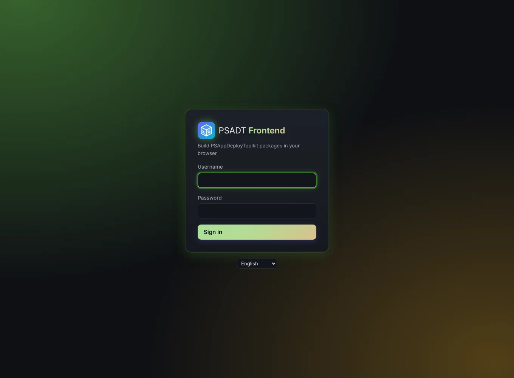

# Getting started

## Signing in

Sign in with your login name and password. After 5 wrong passwords the account is locked for 15 minutes; an administrator can unlock it sooner on the [Users](Users-and-roles) page.

## The menu

The menu on the left has:

- **Packages**: all packages, with the export counters ([Packages](Packages)).
- **Users**: only for administrators ([Users and roles](Users-and-roles)).
- **System**: only for administrators. A dot appears when an update is available ([System](System)).
- **Account**: your full name, password and language ([Account and language](Account-and-language)).
- **Sign out**.

## Autosave

The package editor saves your changes on its own a moment after you stop typing. The top of the editor shows whether everything is saved. If you try to leave the page while a change is not saved yet, the browser asks you first.

## Colours

The app is always dark. The colours of the background glow and the buttons shift a little every night, so the app looks slightly different each day. This has no other effect.
