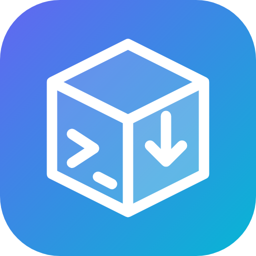
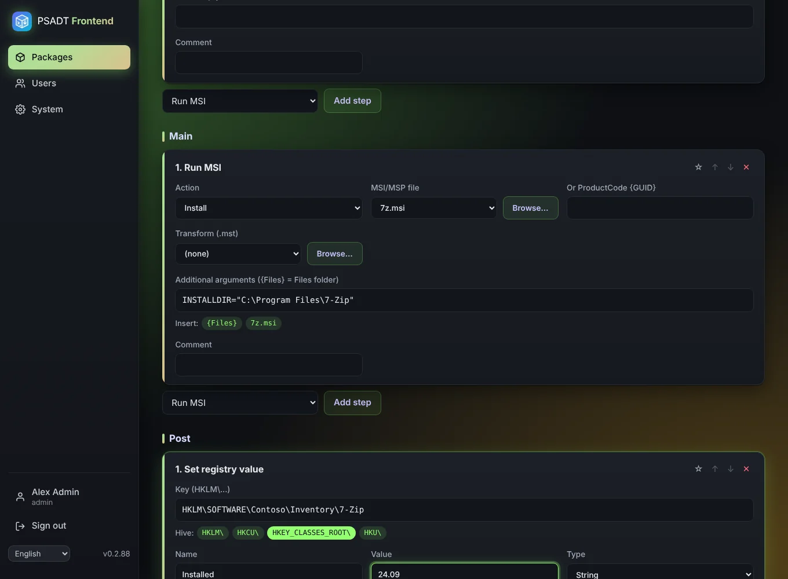

# PSADT Frontend user guide

PSADT Frontend is a web app for building [PSAppDeployToolkit](https://psappdeploytoolkit.com/) v4 packages without a Windows build machine. You describe what the installer should do, upload the installer files, and download a package that is ready for Intune or any other deployment tool.

> 👣 **First time?** Follow [Step by step: your first package](Step-by-step-first-package), a complete walkthrough from an empty screen to an app in Intune.

## How a package is made

1. **[Create a package](Packages)** and fill in the [App info](App-info): vendor, name, version, processes to close.
2. **[Add steps](Install-and-uninstall-steps)** to the Install, Uninstall and Repair tabs, for example *Run MSI* or *Run EXE*.
3. **[Upload the installer files](Files)** the steps use.
4. **[Set detection rules](Detection)** so Intune can see whether the app is installed.
5. **[Look at the script](Script-and-syntax-check)** the app generates for you.
6. **[Export](Export-and-Intune)** as a ZIP or an `.intunewin` and add it to Intune.

## Contents

| Page | What it covers |
|------|----------------|
| [Installation](Installation) | Proxmox one-liner, Docker, existing LXC, settings |
| [Getting started](Getting-started) | First sign-in, the menu, autosave |
| [Step by step: your first package](Step-by-step-first-package) | 50 steps from start to Intune, with 7-Zip as example |
| [Packages](Packages) | The package list, export counters, copy and delete |
| [App info](App-info) | Name, version, exit codes, processes to close, log folder |
| [Install and uninstall steps](Install-and-uninstall-steps) | Every step type, `{Files}`, Browse, winget, snippets |
| [Files](Files) | Uploading installers, progress, retention |
| [Detection](Detection) | MSI ProductCode reader, file, registry, MSIX |
| [Script and syntax check](Script-and-syntax-check) | The generated script and what the check does |
| [Export and Intune](Export-and-Intune) | Check before download, ZIP, `.intunewin`, Intune settings |
| [Users and roles](Users-and-roles) | Administrator, Editor, Read only |
| [Account and language](Account-and-language) | Full name, password, English/Dutch/German |
| [System](System) | Updates, release notes, retention, default log folder |
| [Troubleshooting](Troubleshooting) | Common problems and their fixes |
