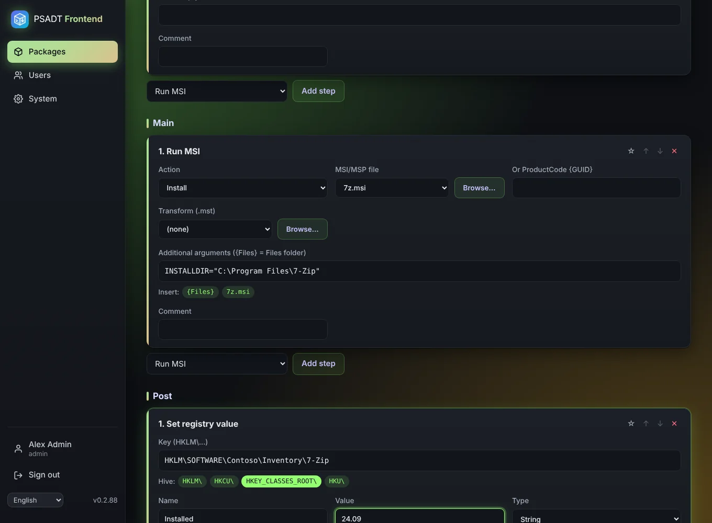
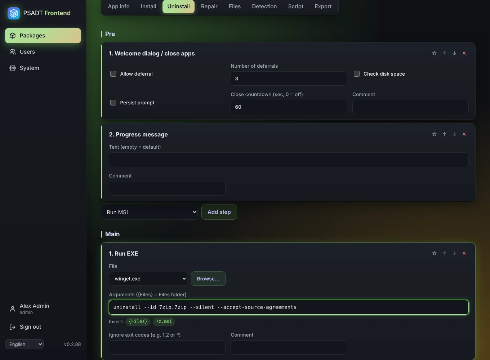

# Install and uninstall steps

The **Install**, **Uninstall** and **Repair** tabs each have three phases:

- **Pre**: before the main work, for example the welcome dialog that closes running apps.
- **Main**: the actual install or uninstall.
- **Post**: clean-up afterwards, such as removing a desktop shortcut or setting a registry value.

Each phase is a block of its own. Pick a step type at the bottom of that block and click **Add step to Pre**, **Add step to Main** or **Add step to Post**. Every step can be moved up or down with ↑ and ↓ (the page scrolls along, so the step stays under your mouse), removed with ✕ (an **Undo** button puts it back for 10 seconds), given a comment (which appears in the script), and saved as a **snippet** so you can reuse it in other packages. Snippets appear in the same list under *Snippets*.

## Step types

| Step | What it does |
|------|--------------|
| Welcome dialog / close apps | Shows the PSADT welcome dialog, asks the user to close the *processes to close*, and can allow deferrals, check disk space and count down. |
| Progress message | Shows a progress window with your own text, or the default text when empty. |
| Run MSI | Installs, uninstalls, repairs or patches an uploaded `.msi`/`.msp`, or a ProductCode. Optional transform (`.mst`) and extra arguments. |
| Run EXE | Runs an uploaded `.exe` or a program that is already on every Windows PC, with arguments. Exit codes can be ignored (e.g. `1,2` or `*`). |
| Uninstall application by name | Finds the app in *Programs and Features* (contains, exact, wildcard or regex) and uninstalls it. |
| Set registry value | Writes a value of type String, ExpandString, DWord, QWord, MultiString or Binary. |
| Remove registry key/value | Removes one value, or the whole key when the name is empty. |
| Copy file | Copies an uploaded file to a folder on the PC. |
| Remove file / Remove folder | Deletes a path on the PC. |
| Custom PowerShell | Inserts your own code into the script exactly as typed. |

## Choosing a file with Browse

File fields have a **Browse…** button. It lists the files you uploaded on the [Files](Files) tab that fit the field, for example only `.msi` files for *Run MSI*. You can upload a new file from there too.

## Windows programs such as winget

In *Run EXE*, **Browse** also offers programs that already exist on every Windows PC: `winget.exe`, `msiexec.exe`, `powershell.exe`, `cmd.exe`, `dism.exe`, `reg.exe`, `regsvr32.exe` and `wusa.exe`. These don't need to be uploaded. Example to uninstall an app with winget:

- File: `winget.exe`
- Arguments: `uninstall --id Acme.App --silent --accept-source-agreements`

## The {Files} placeholder

In arguments, `{Files}` stands for the package's `Files` folder on the PC. Example: `--config "{Files}\settings.xml"`. Under every arguments field are buttons that insert `{Files}` or the full quoted path of an uploaded file at the cursor. Without `{Files}`, arguments are passed exactly as typed.

## Registry keys

Registry fields have buttons for the hives `HKLM`, `HKCU`, `HKEY_CLASSES_ROOT` and `HKU`. Click one to start the key with that hive.
