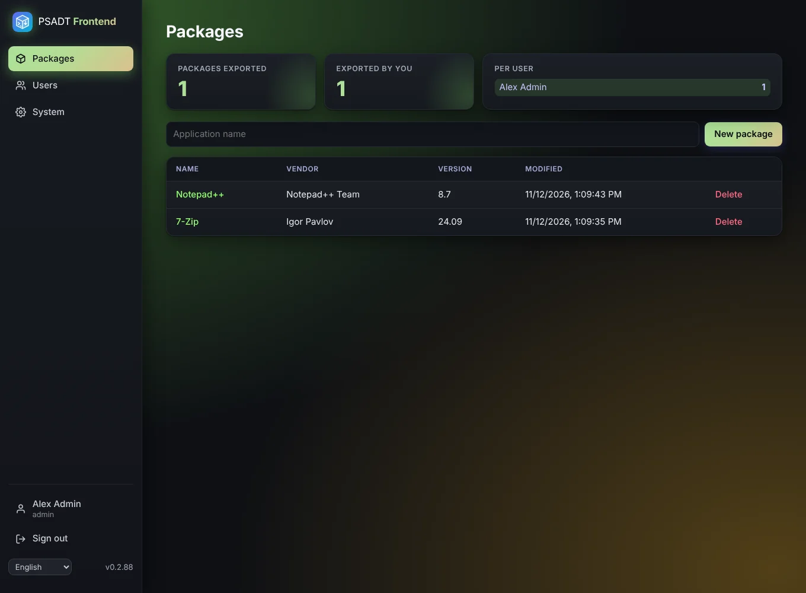

# Packages

The **Packages** page lists every package with its name, vendor, version and when it was last changed. Click a name to open it.

## Export counters

At the top you see three counters:

- **Total**: how many packages have been exported.
- **Yours**: how many of those you exported.
- **Per user**: the count for every user.

A package counts **once per version**. Downloading the same version again, or downloading both the ZIP and the `.intunewin`, does not raise the counter. When you change the version under [App info](App-info) and export again, it counts as a new package. The package counts for the user who downloaded that version first.

## Creating a package

Click **New package**, give it a name, and the [editor](App-info) opens. Editors and administrators can create packages. Only administrators can delete a package (the **Delete** link in the list). Read-only users can view and export them.

## Templates

To reuse a package, open it and click **Save as template** at the top of the editor. A template keeps the app info, all install/uninstall steps and the detection rules. Files are not included.

To start from a template, pick it next to **New package** and fill in a **new version**. That field is required: the same application can't get the same version twice, so the template's own version or a version that already exists as a package is refused with a message. You don't have to type a name: leave it empty and the template's application name is used. **Use** in the template list below the packages picks the template and puts the cursor in the version field. In that list you can also **rename** or **delete** a template.

Click a template's name to see what it does without opening it: for Install, Uninstall and Repair every step with its file and full command line (the install and uninstall strings, including the arguments of *Run EXE* steps), plus the detection rules.

A template usually gets a newer installer later. When you choose another `.msi` in a *Run MSI* step (from the list or with **Browse…**), its ProductCode is read right away: the new GUID replaces the old one in uninstall steps that use a ProductCode and in the MSI detection rules, and the app version is taken from the MSI. A message at the top of the editor shows what was read.
