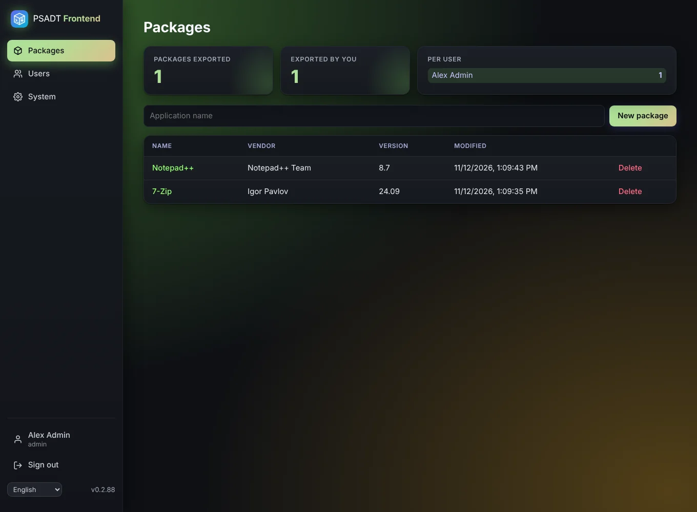

# Packages

The **Packages** page lists every package with its name, vendor, version and when it was last changed. Click a name to open it.

## Export counters

At the top you see three counters:

- **Total**: how many packages have been exported.
- **Yours**: how many of those you exported.
- **Per user**: the count for every user.

A package counts **once per version**. Downloading the same version again, or downloading both the ZIP and the `.intunewin`, does not raise the counter. When you change the version under [App info](App-info) and export again, it counts as a new package. The package counts for the user who downloaded that version first.

## Creating a package

Click **New package**, give it a name, and the [editor](App-info) opens. Editors and administrators can create and delete packages. Read-only users can view and export them.
