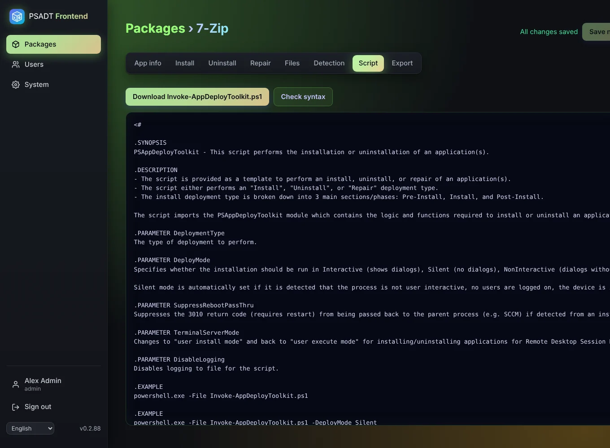

# Script and syntax check

The **Script** tab shows the `Invoke-AppDeployToolkit.ps1` the app generates from your package. It is based on the official PSADT 4.1.8 template, so it looks like a script written by hand. You can copy it, but you never have to edit it: change the package instead and the script follows.

## Syntax check

**Check syntax** gives the script to the PowerShell parser. The parser only *reads* the script and reports typing errors, such as a missing quote or bracket, usually in a *Custom PowerShell* step. **Nothing is run**, not on the server and not anywhere else.

The check needs PowerShell 7 (`pwsh`) on the server. The Docker image and the LXC install include it. If `pwsh` is missing, the app says so and skips the check.
