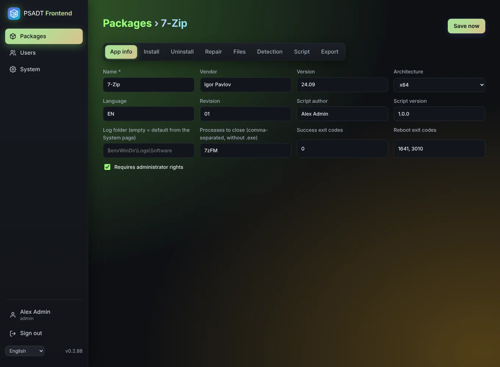
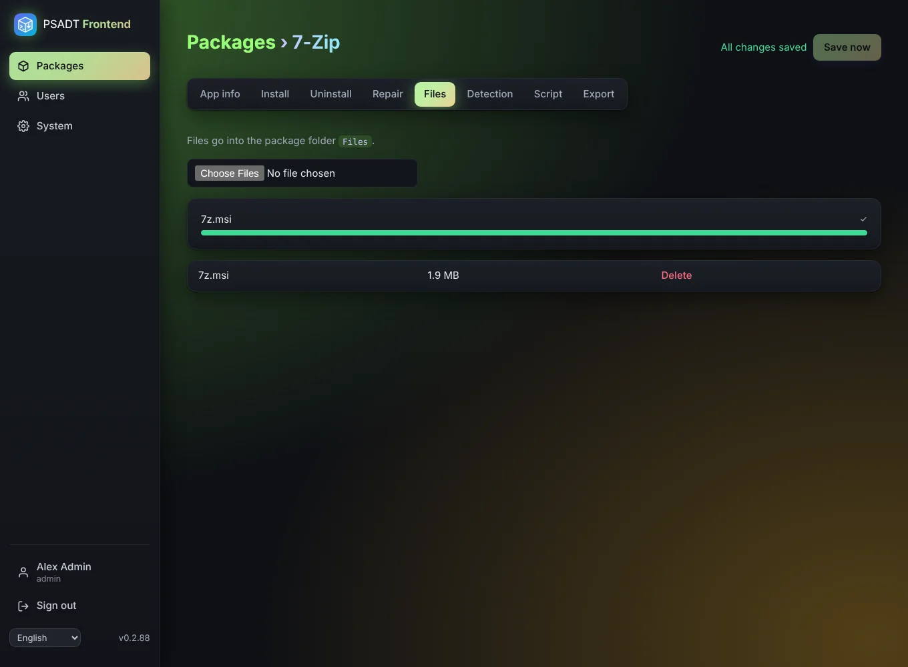
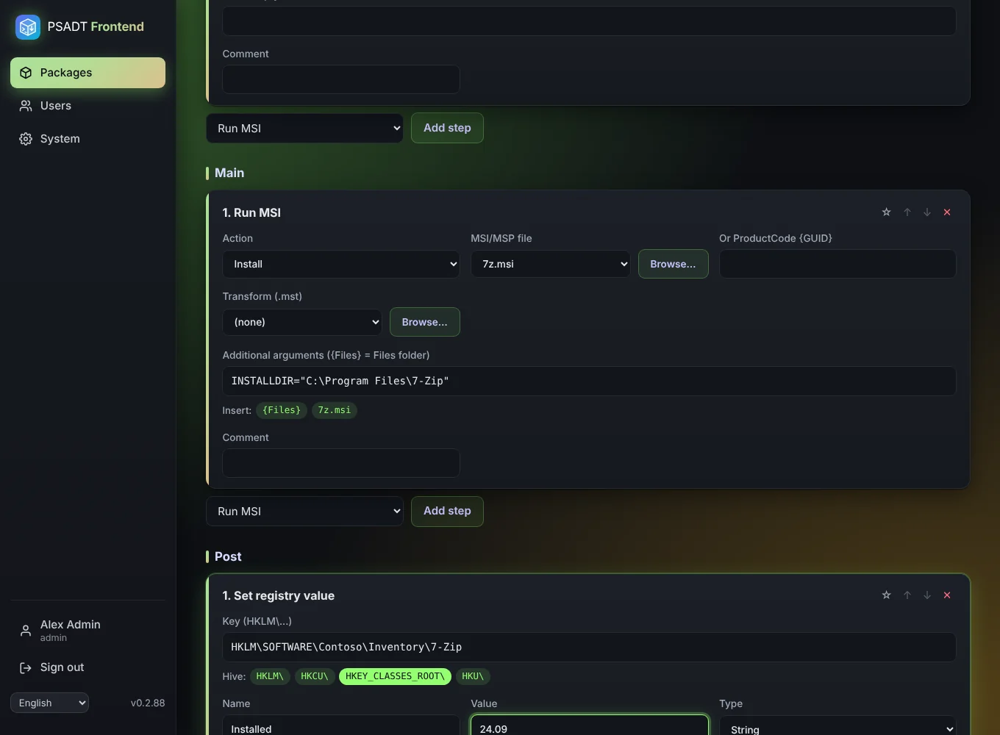
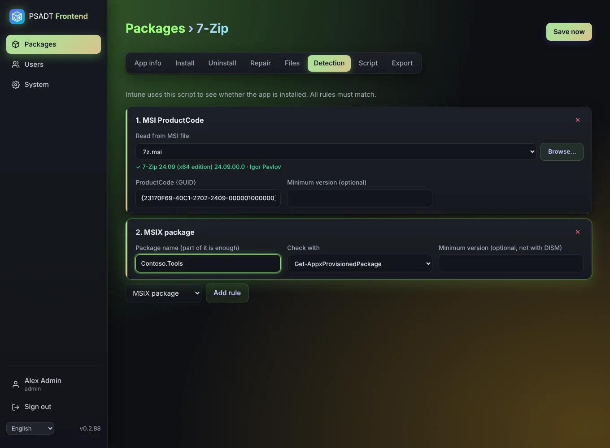
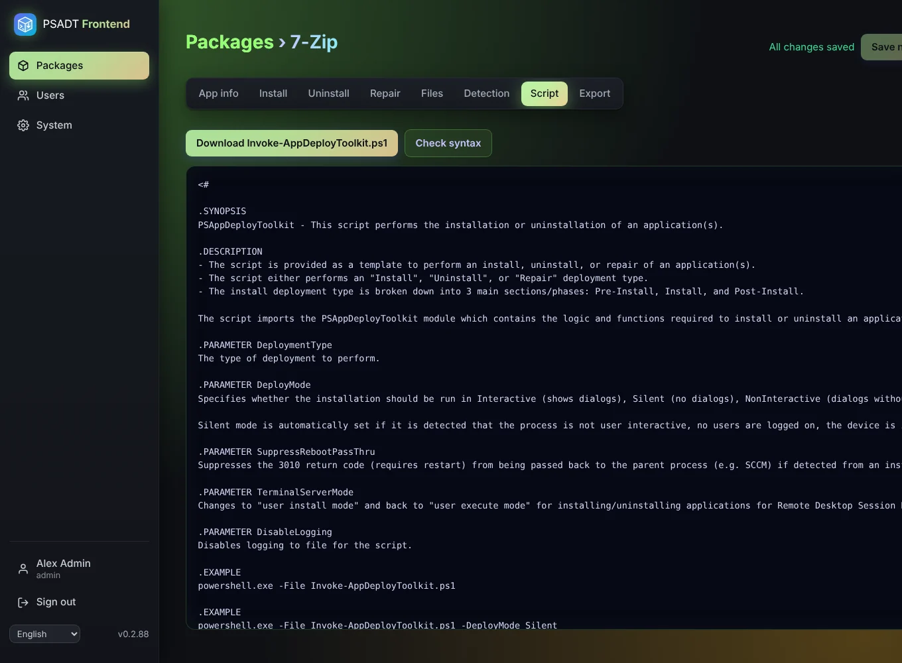
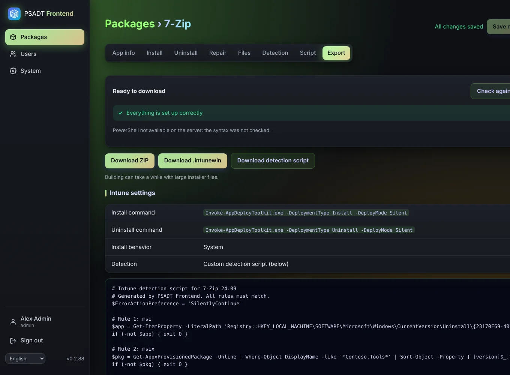

# Step by step: your first package

This page walks you through making one complete package, from an empty screen to an app in Intune. We use **7-Zip** as the example because it is free and comes as an MSI. Follow it once with 7-Zip; after that every other app works the same way.

**What you need before you start**

- An account with the role *Editor* or *Administrator* (a *Read only* account can't create packages).
- The installer on your own PC. For this example: download the **64-bit Windows x64 MSI** from [7-zip.org](https://www.7-zip.org/download.html), for example `7z2409-x64.msi`.
- For the Intune part: access to the Intune admin center.

---

## Part 1: create the package

**Step 1.** Open PSADT Frontend in your browser and sign in.

**Step 2.** Click **Packages** in the menu on the left. You see the list of packages and the export counters.

**Step 3.** Type the name of the app in the field **Application name**, in this example `7-Zip`.

**Step 4.** Click **New package**. The editor opens with the tabs *App info, Install, Uninstall, Repair, Files, Detection, Script* and *Export*.

> From now on everything is saved automatically a moment after you stop typing. At the top right you see **Saving…** and then **All changes saved**. You can also click **Save now**.

---

## Part 2: fill in the app info

**Step 5.** Stay on the **App info** tab (it opens first).

**Step 6.** Fill in the fields:

| Field | Type | Why |
|-------|------|-----|
| Name * | `7-Zip` | Already filled in. Shown in the PSADT dialogs. |
| Vendor | `Igor Pavlov` | Shown in the dialogs and part of the package name. |
| Version | `24.09` | The version of the app. Also used for the [export counter](Packages). |
| Architecture | `x64` | The MSI is 64-bit. |
| Language | `EN` | Leave as it is. |
| Revision | `01` | Raise it to `02` when you rebuild the same version with changes. |
| Script author | your name | Filled in for you from your account. |
| Script version | `1.0.0` | Leave as it is. |
| Log folder | *(empty)* | Empty uses the default from the System page. |
| Processes to close | `7zFM, 7zG` | The 7-Zip file manager and its dialog. Without `.exe`, separated by commas. The install asks the user to close these. |
| Success exit codes | `0` | Leave as it is. |
| Reboot exit codes | `1641, 3010` | Leave as it is. |
| Requires administrator rights | ✔ | 7-Zip installs for the whole PC. |

**Step 7.** Wait until you see **All changes saved**.

---

## Part 3: upload the installer

**Step 8.** Click the **Files** tab.

**Step 9.** Click the file field and choose `7z2409-x64.msi` on your PC. A progress bar shows the upload.

**Step 10.** When the upload is done, the file appears under **Uploaded files** with its size.

---

## Part 4: the install steps

**Step 11.** Click the **Install** tab. You see three phases: **Pre**, **Main** and **Post**.

**Step 12.** Look at **Pre**. A new package already has two steps there:

1. **Welcome dialog / close apps**: asks the user to close 7-Zip (the processes from step 6) and lets them postpone the install 3 times. You can leave the settings as they are.
2. **Progress message**: shows "installation in progress". Leave it.

**Step 13.** Go to the **Main** phase. In the list at the bottom of that phase choose **Run MSI** and click **Add step**.

**Step 14.** Fill in the new *Run MSI* step:

- **Action**: `Install`.
- **MSI/MSP file**: click **Browse…** and choose `7z2409-x64.msi`.
- **Or ProductCode**: leave empty, the file is enough.
- **Transform (.mst)**: leave empty.
- **Additional arguments**: leave empty. PSADT already installs silently and writes an MSI log.
- **Comment** (optional): `Install 7-Zip`. It appears in the script.

**Step 15. (optional)** Want to set something after the install? In **Post**, add for example **Set registry value**. Click the hive button **HKLM\**, then complete the key, name, value and type.

---

## Part 5: the uninstall steps

**Step 16.** Click the **Uninstall** tab. **Pre** already has a welcome dialog (with a 60-second countdown, no postponing) and a progress message.

**Step 17.** In **Main** choose **Run MSI** and click **Add step**.

**Step 18.** Fill it in:

- **Action**: `Uninstall`.
- **MSI/MSP file**: `7z2409-x64.msi` (via **Browse…**). PSADT reads the ProductCode from it.

> **Alternative:** to remove *every* version of 7-Zip, use **Uninstall application by name** with Name `7-Zip` and Match `Contains`. Or uninstall with winget: **Run EXE**, Browse… → *Programs on the Windows PC* → `winget.exe`, Arguments `uninstall --id 7zip.7zip --silent --accept-source-agreements`.

**Step 19.** The **Repair** tab works the same. For 7-Zip you can add **Run MSI** with Action `Repair` and the same file, or leave Repair empty.

---

## Part 6: detection

**Step 20.** Click the **Detection** tab.

**Step 21.** In the list at the bottom choose **MSI ProductCode** and click **Add rule**. The rule appears as *1. MSI ProductCode*.

**Step 22.** In that rule, under **Read from MSI file**, click **Browse…** and choose `7z2409-x64.msi`. The app reads the MSI and fills in **ProductCode {GUID}** for you, for example `{23170F69-40C1-2702-2409-000001000000}`. Under the field a green line shows what it read, such as *✓ 7-Zip 24.09 (x64 edition) 24.09.00.0 · Igor Pavlov*, so you can see it is the right file.

**Step 23. (optional)** Fill in **Minimum version (optional)** with `24.09`, so Intune reinstalls on PCs with an older version.

> Without an MSI? Choose **File** (for example `%ProgramFiles%\7-Zip\7z.exe`), **Registry** or **MSIX package** in the list and click **Add rule**. See [Detection](Detection).

---

## Part 7: check the script

**Step 24.** Click the **Script** tab. You see the full `Invoke-AppDeployToolkit.ps1`. Scroll through it: your app info is at the top, your steps are in the functions *Install-ADTDeployment*, *Uninstall-ADTDeployment* and *Repair-ADTDeployment*.

**Step 25.** Click **Check syntax**. After a moment you see **No syntax errors**. Nothing is run; PowerShell only reads the script.

---

## Part 8: export

**Step 26.** Click the **Export** tab. The app checks the package (**Checking the package…**).

**Step 27.** Read the result:

- **Red**: must be fixed. The text names the step or field; fix it and click **Check again**.
- **Yellow**: only a warning, you can still download.
- **Ready to download**: all good.

**Step 28.** Click **Download .intunewin** (or **Download ZIP** to test by hand first). You see **Building the package…**, then **Downloading…** with a percentage, and finally **✓ Downloaded: …**. The file is in your browser's download folder.

**Step 29.** Click **Download detection script** too. You need it in Intune.

**Step 30.** Write down the commands in the **Intune settings** table:

- Install command: `Invoke-AppDeployToolkit.exe -DeploymentType Install -DeployMode Silent`
- Uninstall command: `Invoke-AppDeployToolkit.exe -DeploymentType Uninstall -DeployMode Silent`

---

## Part 9 (recommended): test on a test PC

**Step 31.** Unzip the **ZIP** on a Windows test PC or VM.

**Step 32.** Open PowerShell **as administrator** in that folder.

**Step 33.** Run `.\Invoke-AppDeployToolkit.exe -DeploymentType Install`. You see the welcome dialog and the progress window, and 7-Zip is installed.

**Step 34.** Check the log in `C:\Windows\Logs\Software` (or your own log folder).

**Step 35.** Run `.\Invoke-AppDeployToolkit.exe -DeploymentType Uninstall` and check that 7-Zip is gone.

---

## Part 10: add the app to Intune

**Step 36.** Open the [Intune admin center](https://intune.microsoft.com) and go to **Apps › Windows › + Add**.

**Step 37.** Choose app type **Windows app (Win32)** and click **Select**.

**Step 38.** Click **Select app package file** and upload the `.intunewin`. Click **OK**.

**Step 39.** On **App information** fill in at least *Name* (`7-Zip`), *Description* and *Publisher* (`Igor Pavlov`). Click **Next**.

**Step 40.** On **Program**:

- Install command: the install command from step 30.
- Uninstall command: the uninstall command from step 30.
- Install behavior: **System**.
- Device restart behavior: **Determine behavior based on return codes**.

Click **Next**.

**Step 41.** On **Requirements** choose *Operating system architecture* **64-bit** and a minimum Windows version. Click **Next**.

**Step 42.** On **Detection rules** choose *Rules format* **Use a custom detection script**, and upload the detection script from step 29. Leave the two options on **No**. Click **Next**.

**Step 43.** Skip *Dependencies* and *Supersedence* (click **Next**).

**Step 44.** On **Assignments** add a test group under *Required* or *Available for enrolled devices*. Click **Next**, then **Create**.

**Step 45.** Wait until a test PC in the group syncs (or click *Sync* in *Company Portal*). 7-Zip is installed, and Intune reports **Installed**.

---

## Part 11: a new version later

**Step 46.** Open the package in **Packages**.

**Step 47.** Upload the new MSI on **Files** and remove the old one.

**Step 48.** In the **Run MSI** steps (Install and Uninstall) pick the new file with **Browse…**.

**Step 49.** On **Detection**, in the MSI ProductCode rule, choose the new MSI under **Read from MSI file**. The ProductCode is replaced by the new one.

**Step 50.** Change **Version** on **App info**, export again, and upload the new `.intunewin` in the existing Intune app (*Properties › App information › Edit*), or make a new app that *supersedes* the old one.

---

**Done.** Next: read [Install and uninstall steps](Install-and-uninstall-steps) for every step type, or [Troubleshooting](Troubleshooting) if something didn't work.
