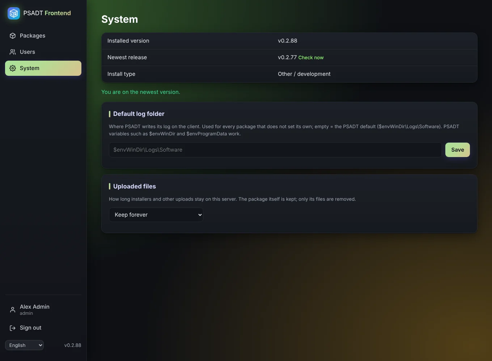

# System

The **System** page is only for administrators.

## Updates

The page shows the installed version and the newest release on GitHub. A dot in the menu and a banner tell administrators when an update is available; **Check now** checks straight away.

- **LXC install**: click **Update**. A progress bar shows the steps. When it's done the service restarts and the page reloads with the new version.
- **Docker**: run `docker compose pull && docker compose up -d` on the host.

**What's new** shows the release notes in plain language, in your own language.

## Upload retention

Choose how long uploaded files stay on the server: forever, until right after a download, or 1, 7, 30 or 90 days. See [Files](Files).

## Default log folder

The folder where PSADT writes its log on the PC, for packages that don't set their own under [App info](App-info). Default: `$envWinDir\Logs\Software`.
