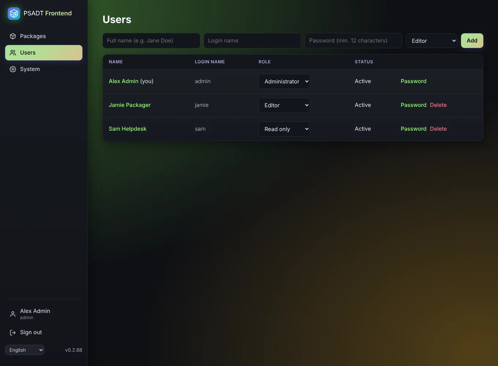

# Users and roles

Administrators manage users on the **Users** page: create, change the role, set a new password, unlock and delete.

| Role | Can |
|------|-----|
| Administrator | Everything, plus users, updates and system settings |
| Editor | Create, change and delete packages and snippets |
| Read only | View everything, check scripts and export |

- Every user has a **login name** (to sign in) and a **full name** (shown in the app and used as script author for new packages).
- When a user's role or password changes, that user is signed out everywhere.
- The last administrator can't be demoted or deleted, so you can't lock yourself out.
- A locked account (5 wrong passwords) unlocks after 15 minutes, or straight away by clicking **Locked, unlock** in the user list.
